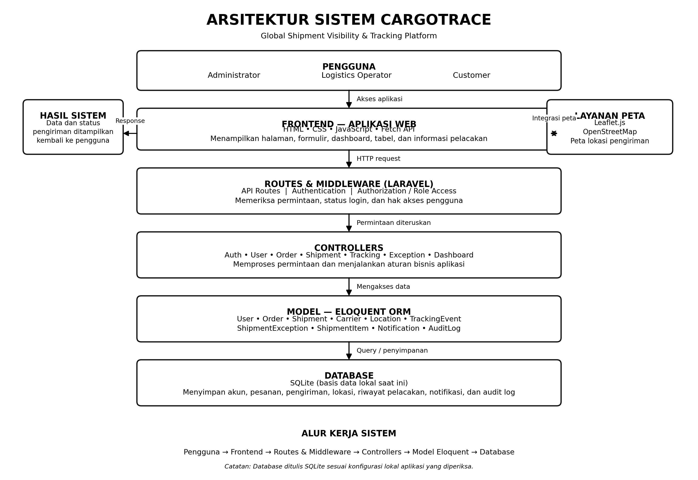
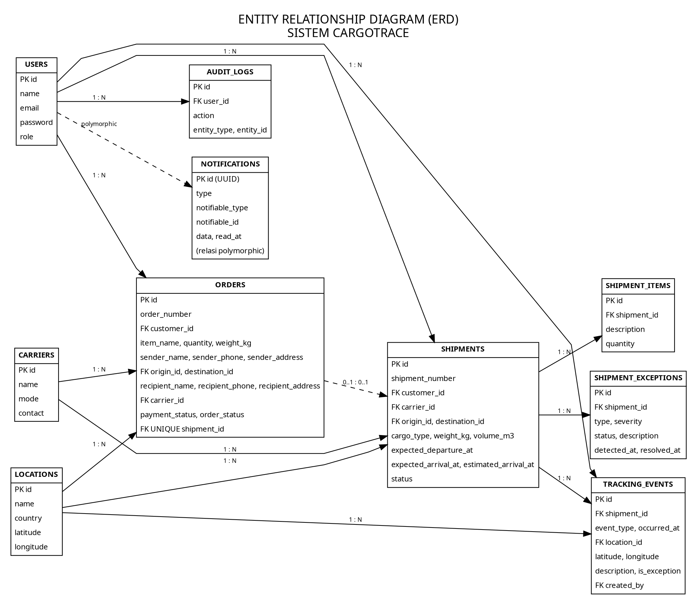

<div align="center">

# CargoTrace
### Global Shipment Visibility & Tracking Platform

**A web-based shipment management and visibility platform**

[Live Application](https://cargotrace-app.ethiodeploy.app/app/index.html) · [GitHub Repository](https://github.com/nurul-aulia03/cargotrace-app)

</div>

---

## Table of Contents

- [1. Project Overview](#1-project-overview)
- [2. Problems and Objectives](#2-problems-and-objectives)
- [3. Main Features](#3-main-features)
- [4. User Roles](#4-user-roles)
- [5. Shipment Lifecycle](#5-shipment-lifecycle)
- [6. Technology Stack](#6-technology-stack)
- [7. System Architecture](#7-system-architecture)
- [8. Database Design](#8-database-design)
- [9. Project Structure](#9-project-structure)
- [10. Requirements](#10-requirements)
- [11. Installation and Setup](#11-installation-and-setup)
- [12. Environment Configuration](#12-environment-configuration)
- [13. Database Migration and Seeding](#13-database-migration-and-seeding)
- [14. Running the Application](#14-running-the-application)
- [15. REST API Documentation](#15-rest-api-documentation)
- [16. Testing](#16-testing)
- [17. Security](#17-security)
- [18. Live Application and Demo Accounts](#18-live-application-and-demo-accounts)
- [19. Deployment Checklist](#19-deployment-checklist)
- [20. Scope and Limitations](#20-scope-and-limitations)
- [21. Project Documentation and Deliverables](#21-project-documentation-and-deliverables)
- [22. Developer](#22-developer)

---

## 1. Project Overview

CargoTrace is a Laravel-based web application developed for the **Web Programming 2 Final Project**. It is designed to centralize shipment information, order handling, tracking records, operational exceptions, and shipment visibility in one platform.

CargoTrace is intended to support three types of users: Administrator, Logistics Operator, and Customer. Each role has different responsibilities and should only access the resources permitted to that role.

The project is more than a basic shipment CRUD application. Its goal is to demonstrate an integrated workflow involving shipment data, status progression, tracking history, operational information, and REST API communication.

## 2. Problems and Objectives

### Problems

- Shipment information can be spread across different operational records.
- Customers need a clear way to check the progress of their shipments.
- Logistics operators need to review shipment updates and operational exceptions.
- Administrators need centralized visibility of application data and activities.

### Objectives

- Centralize order and shipment information.
- Organize shipment status updates through a defined lifecycle.
- Store tracking events and shipment history.
- Provide shipment and location visibility through the application's map-related features.
- Support operational monitoring through dashboard and reporting endpoints.
- Provide role-aware access for administrators, operators, and customers.

## 3. Main Features

CargoTrace provides the following application modules. The descriptions below reflect the registered Laravel API routes and the inspected controller implementation.

| Feature | Description |
|---|---|
| Dashboard | Provides an endpoint for dashboard information and operational summaries. |
| Order Management | Supports order listing, creation, viewing, updating, deletion, approval, cancellation, and rejection. |
| Shipment Management | Supports shipment listing and shipment record operations. |
| Shipment Tracking | Provides tracking history and the ability to add tracking events to a shipment. |
| Exception Management | Supports shipment exceptions and exception history. |
| Carrier Management | Provides carrier listing and carrier creation. |
| Location Management | Supports listing, creation, updating, and deletion of location records. |
| Notifications | Supports notification listing, read status updates, bulk read actions, and deletion. |
| User Authentication | Provides login, registration, logout, and current-user endpoints. |
| User Profile | Supports profile and password updates. |
| News | Provides a news data endpoint. |
| Audit Logs | Provides an audit-log endpoint. |
| User Management | Provides a user data endpoint. |

## 4. User Roles

CargoTrace is designed around three roles:

| Role | Intended responsibilities |
|---|---|
| **Administrator** | Oversees application data and administrative activities. |
| **Logistics Operator** | Handles permitted logistics operations, shipment updates, and exceptions. |
| **Customer** | Creates or accesses orders and monitors shipments associated with their account. |

### Authorization principles

- Authorization must be enforced on the server, not only by hiding frontend buttons.
- Customers must only be able to access their own order and shipment information.
- Operators must only perform actions allowed by their assigned permissions.
- Administrative actions must be restricted to authorized administrators.

Role restrictions are enforced by backend controller checks and authenticated API routes. Customers are limited to their own orders and shipments; staff operations are restricted to administrator or logistics-operator roles as implemented by the relevant controller.

## 5. Shipment Lifecycle

The project specification defines the following shipment lifecycle:

```text
CREATED
   |
   v
BOOKED
   |
   v
PICKED_UP
   |
   v
IN_TRANSIT
   |
   v
DELIVERED
```

The application should validate status transitions and preserve tracking history. Invalid transitions should be rejected by backend business rules and covered by automated tests.

### Tracking information

A tracking record may be used to describe a shipment event, its status, its time, and its associated location. The tracking timeline should help users understand the recorded journey of a shipment.

**GPS clarification:** Map-based location display and recorded tracking events must not be described as live GPS tracking from a physical device unless an actual device/GPS integration has been implemented and verified.

## 6. Technology Stack

### Runtime versions observed during local project inspection

| Component | Observed version or configuration |
|---|---|
| PHP | 8.3.33 |
| Laravel | 13.42.0 |
| Composer | 2.10.3 |
| Database driver | MySQL |
| Local application entry point | `http://127.0.0.1:8000/app/index.html` |
| Local application base URL | `http://127.0.0.1:8000` |

### Technologies referenced by the project specification

- PHP 8.3+
- Laravel
- Blade templates
- MySQL
- Eloquent ORM and database migrations
- Laravel REST API
- Laravel Sanctum (verify installed package and active usage)
- Laravel HTTP Client for external requests
- Vanilla JavaScript and Fetch API
- Leaflet.js and OpenStreetMap for map visualization
- Chart.js for charts
- Node.js and npm for frontend asset management
- PHPUnit or Pest for automated testing
- Git and GitHub
- Postman for API testing

The list above combines the locally observed runtime with technologies specified for the project. Check `composer.json`, `package.json`, and the actual source code before assuming every suggested technology is actively used.

## 7. System Architecture

The intended request flow follows a layered Laravel architecture:

```text
+-----------------------------+
|       Browser / Client      |
+-----------------------------+
              |
              v
+-----------------------------+
|     Routes & Middleware     |
| Authentication / Access     |
+-----------------------------+
              |
              v
+-----------------------------+
|         Controllers         |
| Auth, Orders, Shipments,    |
| Tracking, Exceptions, etc.  |
+-----------------------------+
              |
              v
+-----------------------------+
|       Business Logic        |
| Validation and workflows    |
+-----------------------------+
              |
              v
+-----------------------------+
|       Models / Eloquent     |
+-----------------------------+
              |
              v
+-----------------------------+
|       MySQL Database        |
+-----------------------------+

External services and map providers are accessed
through the relevant application integrations.
```

### Architecture diagram



The diagram presents the application flow from users and the web frontend through Laravel routes and middleware, controllers, Eloquent models, and database storage. **Database configuration note:** the diagram artwork labels the database as SQLite, while the inspected local Laravel environment reports `DB_CONNECTION=mysql`. The running application's `.env` configuration is authoritative; for the inspected local setup, MySQL is used.

## 8. Database Design

The repository includes an Entity Relationship Diagram at:

`docs/ERD_CargoTrace.png`



The ERD shown in the repository includes entities such as users, orders, shipments, carriers, notifications, audit logs, shipment items, and shipment exceptions.

The migration files observed in the local project include:

- `0001_01_01_000000_create_users_table.php`
- `0001_01_01_000001_create_cache_table.php`
- `0001_01_01_000002_create_jobs_table.php`
- `2026_01_01_000001_create_cargotrace_tables.php`
- `2026_11_12_024813_create_personal_access_tokens_table.php`
- `2026_11_19_144149_create_orders_table.php`
- `2026_11_19_172635_make_order_logistics_fields_nullable.php`
- `2026_11_22_052531_create_notifications_table.php`

A file ending in `.bak` was also observed in the migrations directory. It is a backup file, not an active Laravel migration.

For authoritative table columns, indexes, foreign keys, and relationships, refer to the migration files and ERD in the repository.

## 9. Project Structure

A simplified Laravel project structure is shown below:

```text
cargotrace-app/
├── app/
│   ├── Http/
│   │   ├── Controllers/
│   │   └── ...
│   ├── Models/
│   └── ...
├── bootstrap/
├── config/
├── database/
│   ├── migrations/
│   ├── seeders/
│   └── ...
├── docs/
│   ├── Arsitektur_CargoTrace.png
│   └── ERD_CargoTrace.png
├── public/
├── resources/
├── routes/
│   ├── api.php
│   └── web.php
├── storage/
├── tests/
├── .env.example
├── artisan
├── composer.json
├── package.json
└── README.md
```

This is a simplified overview. The actual repository may contain additional files and directories.

## 10. Requirements

Prepare the following software before installation:

- PHP 8.3 or later.
- Composer 2.x.
- MySQL or a compatible MySQL/MariaDB server.
- Node.js and npm if frontend assets need to be installed or compiled.
- Git (optional, for cloning the repository).

Required PHP extensions depend on the packages listed in `composer.json`. Composer will report missing extensions during dependency installation.

### Windows / Laragon note

The local environment inspected for this project contains PHP 8.3.33 at:

```text
C:\laragon\bin\php\php-8.3.33-Win32-vs16-x64\php.exe
```

Ensure that the terminal uses PHP 8.3 or later. A different PHP executable earlier in the Windows PATH may cause Composer or Artisan platform errors.

## 11. Installation and Setup

### 11.1 Clone the repository

```bash
git clone https://github.com/nurul-aulia03/cargotrace-app.git
cd cargotrace-app
```

### 11.2 Install PHP dependencies

```bash
composer install
```

### 11.3 Create the environment file

Windows PowerShell:

```powershell
Copy-Item .env.example .env
```

If `.env.example` is missing, prepare a local `.env` file using the variables required by the application. Never commit real secrets.

### 11.4 Generate the application key

```bash
php artisan key:generate
```

### 11.5 Install frontend dependencies

If frontend assets are managed through `package.json`:

```bash
npm install
npm run build
```

For frontend development:

```bash
npm run dev
```

## 12. Environment Configuration

Configure the local `.env` file to match your database and application environment.

Example local configuration:

```dotenv
APP_NAME=CargoTrace
APP_ENV=local
APP_KEY=
APP_DEBUG=true
APP_URL=http://127.0.0.1:8000

DB_CONNECTION=mysql
DB_HOST=127.0.0.1
DB_PORT=3306
DB_DATABASE=cargotrace
DB_USERNAME=root
DB_PASSWORD=
```

These values are examples for a local development environment. Adjust the database name, username, password, host, and port to match your machine.

After changing environment configuration, run:

```bash
php artisan config:clear
```

Do not upload `.env` or real credentials to GitHub. Keep `.env.example` free of secrets.

## 13. Database Migration and Seeding

Create the database in MySQL before running migrations.

Check migration status:

```bash
php artisan migrate:status
```

For a new, empty development database, run:

```bash
php artisan migrate
```

If the project has seeders and they have been reviewed for the target environment:

```bash
php artisan db:seed
```

> **Warning:** Do not use `php artisan migrate:fresh` on a database containing data you need. It drops existing tables and data before recreating them.

## 14. Running the Application

Start the Laravel development server:

```bash
php artisan serve
```

Open the local CargoTrace web interface at:

```text
http://127.0.0.1:8000/app/index.html
```

The `/app/index.html` path is the local application entry point used by this project. The local API base URL remains `http://127.0.0.1:8000/api`.

If the frontend uses a build process, ensure the assets have been built. If the project requires a separate development asset server, run `npm run dev` in another terminal.

## 15. REST API Documentation

The project exposes **42 registered API routes** in the inspected local environment. The route list can be checked using:

```bash
php artisan route:list --path=api
```

The base URL for local API requests is:

```text
http://127.0.0.1:8000/api
```

### Authentication and user endpoints

| Method | Endpoint | Purpose |
|---|---|---|
| POST | `/login` | Authenticate a user |
| POST | `/logout` | End the authenticated session/token |
| POST | `/register` | Register a user |
| GET | `/user` | Retrieve the current authenticated user |
| GET | `/users` | Retrieve user data |
| PATCH | `/profile` | Update profile |
| POST | `/profile/password` | Update password |

### Dashboard and audit endpoints

| Method | Endpoint | Purpose |
|---|---|---|
| GET | `/dashboard` | Retrieve dashboard data |
| GET | `/audit-logs` | Retrieve audit-log data |
| GET | `/news` | Retrieve news data |

### Order endpoints

| Method | Endpoint | Purpose |
|---|---|---|
| GET | `/orders` | List orders |
| POST | `/orders` | Create an order |
| GET | `/orders/{order}` | Retrieve an order |
| PUT / PATCH | `/orders/{order}` | Update an order |
| DELETE | `/orders/{order}` | Delete an order |
| POST | `/orders/{order}/approve` | Approve an order |
| POST | `/orders/{order}/cancel` | Cancel an order |
| POST | `/orders/{order}/reject` | Reject an order |

### Shipment and tracking endpoints

| Method | Endpoint | Purpose |
|---|---|---|
| GET | `/shipments` | List shipments |
| POST | `/shipments` | Create a shipment |
| GET | `/shipments/{shipment}` | Retrieve a shipment |
| PUT / PATCH | `/shipments/{shipment}` | Update a shipment |
| DELETE | `/shipments/{shipment}` | Delete a shipment |
| GET | `/shipments/{shipment}/tracking` | Retrieve shipment tracking history |
| POST | `/shipments/{shipment}/tracking` | Add a tracking event |
| GET | `/shipments/{shipment}/exceptions` | Retrieve shipment exceptions |
| POST | `/shipments/{shipment}/exceptions` | Create a shipment exception |

### Exception endpoints

| Method | Endpoint | Purpose |
|---|---|---|
| GET | `/exceptions` | List exceptions |
| PATCH | `/exceptions/{exception}` | Update an exception |
| GET | `/exceptions/{exception}/history` | Retrieve exception history |

### Carrier and location endpoints

| Method | Endpoint | Purpose |
|---|---|---|
| GET | `/carriers` | List carriers |
| POST | `/carriers` | Create a carrier |
| GET | `/locations` | List locations |
| POST | `/locations` | Create a location |
| PUT | `/locations/{location}` | Update a location |
| DELETE | `/locations/{location}` | Delete a location |

### Notification endpoints

| Method | Endpoint | Purpose |
|---|---|---|
| GET | `/notifications` | List notifications |
| POST | `/notifications/read-all` | Mark all notifications as read |
| PATCH | `/notifications/{notification}/read` | Mark a notification as read |
| DELETE | `/notifications/{notification}` | Delete a notification |

### API implementation notes

- The inspected API routes place the main application endpoints behind `auth:sanctum`; login and registration are public endpoints with request throttling.
- Registration creates customer accounts. Role assignment is not accepted from the registration payload.
- Customers can access their own order and shipment records. Staff-only operations are enforced in the controllers.
- Order approval by staff creates the associated shipment, tracking event, and logistics details. Customer orders can be created while awaiting operator review.
- Tracking updates are validated against the configured shipment lifecycle and event chronology.
- The route table documents endpoint availability; request validation and response details are implemented in the corresponding controllers.

## 16. Testing

Run the automated test suite:

```bash
php artisan test
```

The automated test suite was run in the inspected local project environment:

<escape>```text
Tests: 29 passed
Assertions: 109
Duration: 55.47 seconds
```</escape>

The passing tests cover authentication, protected endpoints, customer shipment isolation, shipment validation, valid and invalid tracking status transitions, delay rules, operator exception workflows, and order creation, updating, approval, rejection, cancellation, and deletion permissions. This result records the test run observed during project documentation review; run `php artisan test` again after subsequent code changes.

## 17. Security

Security must be enforced by the backend. Review the implementation for:

- Password hashing.
- Authentication middleware.
- Server-side authorization and role checks.
- Request validation.
- CSRF protection for applicable web requests.
- Output escaping to reduce cross-site scripting risk.
- Safe database queries and SQL injection prevention.
- Eloquent mass-assignment protection.
- Secure handling of API keys and environment variables.
- Customer data isolation.

Never publish real user data, passwords, tokens, private keys, or production `.env` files.

## 18. Live Application and Demo Accounts

### Live application

[Open CargoTrace Live Application](https://cargotrace-app.ethiodeploy.app/app/index.html)

### Source code

[GitHub Repository — nurul-aulia03/cargotrace-app](https://github.com/nurul-aulia03/cargotrace-app)

### Demo login accounts

The project documentation has previously listed the following demonstration account email addresses:

| Role | Email |
|---|---|
| Administrator | `admin@cargotrace.test` |
| Logistics Operator | `operator@cargotrace.test` |
| Customer | `customer@cargotrace.test` |

The previously documented password is `password`, but the hosted credentials have not been re-tested during this documentation update. Treat these as local/demo references only and verify them before presenting them as working hosted accounts.

> Demo accounts are for academic demonstration only. Do not use real personal information or production credentials in public demo accounts. Change or disable shared credentials if they expose sensitive data.

## 19. Deployment Checklist

Before deploying a production version:

1. Configure production environment variables.
2. Set `APP_ENV=production`.
3. Set `APP_DEBUG=false`.
4. Set `APP_URL` to the deployed domain.
5. Configure the production database and credentials.
6. Install dependencies using the deployment process.
7. Build frontend assets.
8. Run reviewed database migrations during a planned deployment.
9. Ensure Laravel storage and cache directories have the required permissions.
10. Configure the web server document root to the Laravel `public` directory.
11. Enable HTTPS.
12. Verify authentication, role permissions, order workflows, shipment updates, tracking, notifications, and error handling.

After confirming the production environment, Laravel optimization commands may include:

```bash
php artisan config:cache
php artisan route:cache
php artisan view:cache
```

Do not enable debug mode or use local development credentials in production.

## 20. Scope and Limitations

The project specification identifies the following as outside the mandatory MVP scope:

- Direct integration with real ports, customs systems, or real carrier systems.
- Real financial payments or commercial transactions.
- Live GPS tracking from physical devices.
- Mandatory machine-learning or AI prediction.
- Complex microservices architecture.

Map-based location visibility and recorded tracking events are within the intended project scope. They should not be presented as live physical-device GPS tracking unless that integration is implemented and verified.

Demonstration data may be synthetic, but it should be consistent, realistic, and documented.

## 21. Project Documentation and Deliverables

The repository currently includes these technical documentation files:

| File | Description |
|---|---|
| `docs/Arsitektur_CargoTrace.png` | System architecture diagram (black and white) |
| `docs/ERD_CargoTrace.png` | Entity Relationship Diagram (black and white) |

Recommended final repository deliverables:

- English README.
- `.env.example` without secrets.
- Architecture diagram matching the implemented database and application.
- ERD and, where useful, a data dictionary.
- Tested Postman collection and environment template with no secrets.
- Screenshots of the actual application.
- Automated test results.
- Deployment instructions and a working demo link.

### Recommended application screenshots

Add screenshots from the actual running application, for example:

```text
docs/
├── Arsitektur_CargoTrace.png
├── ERD_CargoTrace.png
└── screenshots/
    ├── login.png
    ├── admin-dashboard.png
    ├── operator-dashboard.png
    ├── customer-dashboard.png
    ├── shipment-management.png
    ├── tracking-timeline.png
    └── shipment-map.png
```

Only include screenshots that exist and reflect the current application.

## 22. Developer

**CargoTrace — Web Programming 2 Final Project**

**Project title:** Global Shipment Visibility & Tracking Platform

**Repository:** [github.com/nurul-aulia03/cargotrace-app](https://github.com/nurul-aulia03/cargotrace-app)

---

<div align="center">

© 2026 CargoTrace. All rights reserved.

</div>
